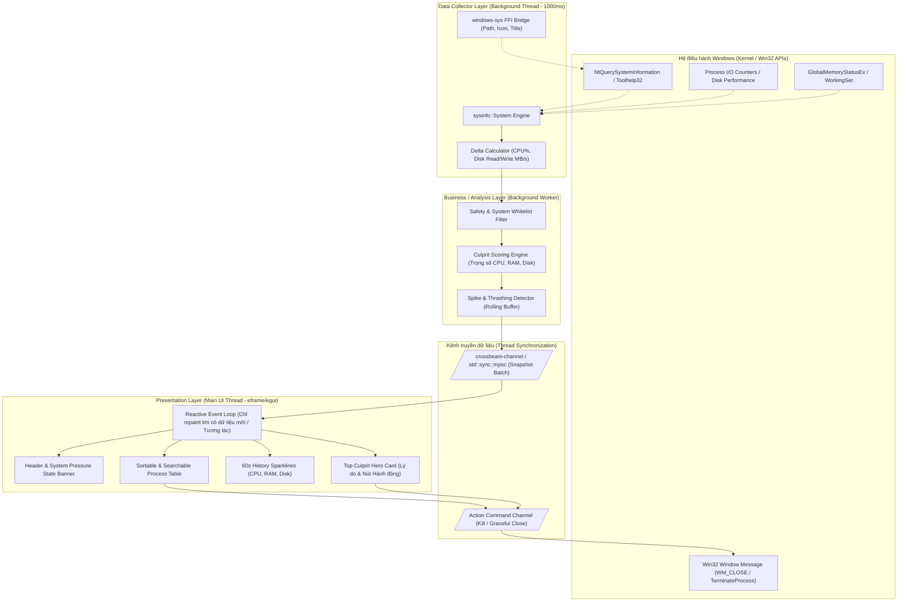

# Tài liệu Kiến trúc Hệ thống — SlowSpot

| Phiên bản | Trạng thái | Ngày tạo | Tác giả |
| :--- | :--- | :--- | :--- |
| 1.0.0 | Dự thảo hoàn thiện (Ready for Review) | 05/11/2026 | SlowSpot Core Team (Agent Docs) |

---

## 1. Tổng quan Kiến trúc (Architectural Overview)

SlowSpot được thiết kế theo mô hình kiến trúc phân lớp tách biệt (Decoupled Layered Architecture) kết hợp mô hình luồng bất đồng bộ dựa trên việc truyền thông điệp (Message Passing Concurrency). 

Mục tiêu cốt lõi của kiến trúc là: **Không bao giờ làm đơ giao diện người dùng, không bao giờ tự biến mình thành tác nhân làm chậm máy tính, và đóng gói độc lập trong MỘT file `.exe` duy nhất.**

### 1.1. Sơ đồ Kiến trúc Tổng thể (System Architecture Diagram)



### 1.2. Sơ đồ Kiến trúc dạng ASCII (ASCII Architectural Overview)

```
+=============================================================================+
|                      WINDOWS 10 / 11 64-BIT ENVIRONMENT                      |
+=============================================================================+
         │                                                      ▲
         │ (Poll 1000ms)                                        │ (Win32 Action)
         ▼                                                      │
+─────────────────────────────────+                   +───────────────────────+
|      BACKGROUND WORKER THREAD   |                   |    NATIVE ACTIONS     |
| ┌─────────────────────────────┐ |                   |  - WM_CLOSE (Graceful)|
| │ module `collector`          │ |                   |  - TerminateProcess   |
| │  - sysinfo (CPU, RAM, Disk) │ |                   |  - ShellExecuteEx     |
| │  - Delta Rate Calculation   │ |                   +───────────────────────+
| └──────────────┬──────────────┘ |                               ▲
|                ▼                |                               │
| ┌─────────────────────────────┐ |                               │
| │ module `analyzer`           │ |                               │
| │  - SafetyFilter (Whitelist) │ |                               │
| │  - CulpritScorer (0-100 pts)│ |                               │
| │  - SpikeDetector (Damping)  │ |                               │
| └──────────────┬──────────────┘ |                               │
+────────────────┼────────────────+                               │
                 │                                                │
       (Channel: `SystemSnapshot`)                  (Channel: `ActionCommand`)
                 │                                                │
                 ▼                                                │
+─────────────────────────────────────────────────────────────────┼───────────+
|                       MAIN THREAD (UI RUNTIME)                  │           |
| ┌─────────────────────────────────────────────────────────────┐ │           |
| │ module `ui` (eframe / egui - Immediate Mode with Reactive)  │ ┼───────────┘
| │                                                             │
| │  [ BANNER ]   Tình trạng: Căng thẳng (CPU 92%, Đĩa 98%)     │
| │  [ CARD ]     Thủ phạm: premiere.exe (Score 91/100) -> [TẮT]│
| │  [ CHARTS ]   Sparkline 60s: CPU [||||||||||  ]             │
| │  [ TABLE ]    Danh sách tiến trình chi tiết (Filter/Search) │
| └─────────────────────────────────────────────────────────────┘
+=============================================================================+
```

---

## 2. Bóc tách Module và Trách nhiệm (Modules & Responsibilities)

Dự án được phân rã thành 6 module nội bộ theo chuẩn Rust idiom:

| Tên Module | Trách nhiệm chính | Thành phần / Structs trọng tâm |
| :--- | :--- | :--- |
| **`model`** | Định nghĩa toàn bộ schema dữ liệu, kiểu dữ liệu chung và các enum biểu diễn trạng thái của hệ thống và tiến trình. | `ProcessRecord`, `SystemSnapshot`, `CulpritCandidate`, `SystemPressureState`, `ProcessKind`, `ActionCommand`. |
| **`collector`** | Quản lý vòng lặp chạy nền định kỳ (mặc định 1000ms), đọc dữ liệu thô từ hệ điều hành, tính toán delta tốc độ CPU và Đọc/Ghi đĩa giữa 2 chu kỳ lấy mẫu liên tiếp. | `SystemCollector`, `MetricSample`, `CollectorConfig`. |
| **`analyzer`** | Nhận dữ liệu từ `collector`, lọc tiến trình qua `SafetyFilter`, chạy thuật toán tính điểm `CulpritEngine`, phát hiện đột biến (`SpikeDetector`), xếp hạng Top thủ phạm. | `CulpritEngine`, `SafetyFilter`, `ScoreWeights`, `SpikeHistory`. |
| **`platform`** | Trừu tượng hóa các lời gọi Win32 API đặc thù: lấy đường dẫn thực thi của process, lấy icon ứng dụng, thực thi đóng an toàn qua thông điệp cửa sổ hoặc ép buộc tắt. | `ProcessController`, `win32_utils`, `ElevationManager`. |
| **`ui`** | Kết xuất giao diện người dùng bằng `eframe`/`egui`. Render các thẻ thông tin, bảng dữ liệu, biểu đồ mini (sparklines), quản lý trạng thái hiển thị (Theme, Search, Filter). | `SlowSpotApp`, `HeaderView`, `CulpritCardView`, `ProcessTableView`, `SparklineView`. |
| **`config`** | Quản lý cấu hình chạy của ứng dụng: chu kỳ lấy mẫu (tick rate), ngưỡng cảnh báo điểm số, danh sách tiến trình người dùng tự bỏ qua (User Ignore List). | `AppConfig`, `ThresholdSettings`. |

---

## 3. Luồng Dữ liệu & Thuật toán Tính điểm (Data Pipeline & Scoring Algorithm)

### 3.1. Luồng Dữ liệu Ba bước (3-Stage Pipeline)

1. **Thu thập (Collection - Stage 1)**:
   - `collector` giữ một instance `sysinfo::System`.
   - Cứ mỗi 1000ms (hoặc khoảng thời gian cấu hình), gọi `refresh_processes_specifics` và `refresh_cpu_usage`.
   - Với mỗi PID, tính:
     - $\Delta \text{CPU} = \frac{\text{CPU Time}_{T} - \text{CPU Time}_{T-1}}{\Delta T \times \text{Logical Cores}}$ (chuẩn hóa về 0% - 100%).
     - $\text{Disk Read Rate} = \frac{\text{ReadBytes}_{T} - \text{ReadBytes}_{T-1}}{\Delta T}$ (Bytes/s).
     - $\text{Disk Write Rate} = \frac{\text{WriteBytes}_{T} - \text{WriteBytes}_{T-1}}{\Delta T}$ (Bytes/s).
     - $\text{Memory Working Set}$ (Bytes).
2. **Phân tích & Tính điểm (Analysis & Scoring - Stage 2)**:
   - Loại trừ `System Idle Process` (PID 0) và bản thân tiến trình `slowspot.exe`.
   - Kiểm tra `SafetyFilter`: Nếu process nằm trong danh sách tiến trình sống còn của Windows, gắn cờ `ProcessKind::SystemCritical` (không cho phép người dùng kill để tránh BSOD).
   - Đưa qua công thức chấm điểm `Culprit Score` (xem mục 3.2).
   - Đưa điểm vào bộ lọc giảm xóc thời gian (`Damping Window` 3 chu kỳ) để tránh hiện tượng danh sách nhảy loạn khi có tác vụ chỉ nháy CPU trong 100ms.
3. **Hiển thị (Presentation - Stage 3)**:
   - Gói toàn bộ dữ liệu vào cấu trúc `SystemSnapshot` và gửi qua unbounded channel tới UI.
   - UI thread nhận snapshot mới nhất và kích hoạt `request_repaint()`.

### 3.2. Thuật toán Tính điểm Thủ phạm (`Culprit Score`)

Mục tiêu của thuật toán là phản ánh chính xác cảm nhận giật lag của người dùng thực tế. Nghẽn ổ đĩa (Disk 100%) hoặc cạn kiệt RAM (gây tráo đổi trang đĩa - paging thrashing) gây đứng máy nặng nề hơn rất nhiều so với việc CPU ở mức 80% nhưng đĩa và RAM vẫn nhàn rỗi.

Điểm thủ phạm $S \in [0, 100]$ của một tiến trình được tính như sau:

$$S = \min\left(100, \; w_{\text{cpu}} \cdot f_{\text{cpu}}(C) + w_{\text{disk}} \cdot f_{\text{disk}}(D) + w_{\text{ram}} \cdot f_{\text{ram}}(M) + B_{\text{spike}}\right)$$

#### Trọng số mặc định:
- $w_{\text{cpu}} = 0.40$ (Tỷ trọng CPU: 40%)
- $w_{\text{disk}} = 0.35$ (Tỷ trọng Đĩa I/O: 35% — Cổ chai nguy hiểm nhất với máy HDD / SATA SSD)
- $w_{\text{ram}} = 0.25$ (Tỷ trọng RAM Pressure: 25%)

#### Các hàm chuẩn hóa thành phần:
1. **Thành phần CPU ($f_{\text{cpu}}$)**:
   $$f_{\text{cpu}}(C) = \begin{cases} 
   0 & \text{nếu } C < 5\% \\
   \left(\frac{C - 5}{95}\right)^{1.2} \times 100 & \text{nếu } C \ge 5\%
   \end{cases}$$
   *(Sử dụng lũy thừa 1.2 để phạt mạnh các tiến trình ăn CPU trên 70%).*

2. **Thành phần Đĩa I/O ($f_{\text{disk}}$)**:
   Tổng tốc độ đĩa $D = \text{ReadRate} + \text{WriteRate}$ (MB/s).
   $$f_{\text{disk}}(D) = \min\left(100, \; \frac{D}{D_{\text{threshold}}} \times 100\right)$$
   *(Trong đó $D_{\text{threshold}}$ mặc định là $50\text{ MB/s}$ đối với ổ cứng HDD/SATA SSD thông thường).*

3. **Thành phần Áp lực Bộ nhớ ($f_{\text{ram}}$)**:
   Nếu tổng dung lượng RAM toàn hệ thống đã sử dụng $> 85\%$, thành phần RAM của từng tiến trình sẽ được tính theo tỷ lệ chiếm dụng trên tổng dung lượng RAM vật lý:
   $$f_{\text{ram}}(M) = \begin{cases}
   0 & \text{nếu RAM hệ thống } \le 80\% \\
   \left(\frac{M_{\text{process}}}{M_{\text{system\_total}}}\right) \times 100 \times 1.5 & \text{nếu RAM hệ thống } > 80\%
   \end{cases}$$

4. **Điểm thưởng đột biến ($B_{\text{spike}}$)**:
   Nếu tốc độ tăng trưởng $\Delta \text{CPU} > 40\%$ hoặc $\Delta \text{Disk} > 30\text{ MB/s}$ chỉ trong vòng 1 giây, cộng thêm điểm phạt đột biến $B_{\text{spike}} = 15$ điểm để ngay lập tức kéo sự chú ý vào ứng dụng vừa bộc phát hành vi bất thường.

#### Phân cấp Ngưỡng Cảnh báo:
- **$S \ge 70$ (Màu Đỏ - Thủ phạm Nghiêm trọng / Critical Culprit)**: Chắc chắn đang làm chậm máy. Hiển thị to trên thẻ Hero Card.
- **$40 \le S < 70$ (Màu Vàng/Cam - Đáng ngờ / Suspicious)**: Đang chiếm tài nguyên đáng kể, cần lưu ý.
- **$S < 40$ (Màu Xanh / Xám - Bình thường / Normal)**: Hoạt động trong giới hạn an toàn.

---

## 4. Khảo sát & Lựa chọn Công nghệ (Tech Stack Evaluation)

Theo định hướng: **Đơn giản, ít dependency, biên dịch nhanh, file exe nhỏ, portable không phụ thuộc runtime ngoài.**

### 4.1. Hạng mục Giao diện Đồ họa (GUI Framework)

| Tiêu chí so sánh | `eframe` / `egui` | `slint` | `iced` | `native-windows-gui` / `windows-rs` |
| :--- | :--- | :--- | :--- | :--- |
| **Phiên bản khảo sát** | `0.37.0` | `1.18.1` | `0.14.0` | `native-windows-gui 1.0.13` / `windows 0.62.2` |
| **Mô hình lập trình** | Immediate Mode (Cực kỳ trực quan, dễ quản lý state) | Declarative DSL riêng (`.slint`) | Retained Mode / The Elm Architecture | Win32 API Event Loop truyền thống |
| **Thời gian build & Dependency** | Rất nhanh, thuần Rust, rất ít phụ thuộc C++ | Lâu hơn (cần build script xử lý file DSL, backend C++/Rust) | Chậm (kéo theo toàn bộ `wgpu` ecosystem nặng nề) | Rất nhanh (gọi thẳng Win32 DLL hệ thống) |
| **Kích thước file thực thi release** | ~5 MB - 9 MB (sau strip & LTO) | ~8 MB - 14 MB | ~12 MB - 20 MB | ~1.5 MB - 3 MB |
| **Độ tương thích phần cứng cũ (No GPU)** | Tuyệt vời với backend **`glow`** (OpenGL 2.1+ / OpenGL ES / Software WARP fallback) | Tốt (hỗ trợ software renderer) | Kém trên máy quá cũ do yêu cầu Vulkan/DirectX 12 của wgpu | Tối đa (sử dụng trực tiếp GDI/User32 của Windows) |
| **Khả năng tùy biến giao diện / Biểu đồ** | Cực kỳ linh hoạt, vẽ custom shape/sparkline trong 5 dòng code | Tốt nhưng phụ thuộc vào cú pháp DSL | Tốt nhưng boilerplate nhiều | Rất cực khổ, vẽ biểu đồ phải tự xử lý GDI/Direct2D |
| **Tình trạng duy trì** | Rất tích cực, cộng đồng Rust GUI số 1 | Tích cực, công ty thương mại chống lưng | Tích cực | `native-windows-gui` đã ngừng cập nhật 4 năm trước |

> [!IMPORTANT]
> **KHUYẾN NGHỊ CHÍNH THỨC CHO GUI: `eframe = "0.37.0"` (với backend `glow`)**
> 
> **Lý do chọn**:
> 1. `egui` có kiến trúc Immediate Mode giúp việc hiển thị bảng số liệu thay đổi liên tục mỗi giây trở nên vô cùng đơn giản, không cần cơ chế đồng bộ DOM/Widget state phức tạp.
> 2. Sử dụng backend `glow` (OpenGL) cho phép ứng dụng mở mượt mà trên cả những chiếc PC văn phòng cũ không có card màn hình rời hoặc driver DirectX bị lỗi.
> 3. Tốc độ biên dịch vượt trội so với `iced` và không yêu cầu cài đặt thêm công cụ build DSL bên ngoài như `slint`.
> 
> **Rủi ro và Biện pháp xử lý**:
> - *Rủi ro ngốn CPU do vẽ lại liên tục*: Mặc định Immediate Mode vẽ 60 FPS liên tục có thể ngốn 3-5% CPU máy yếu.  
>   $\rightarrow$ **Khắc phục**: Cấu hình chế độ **Reactive Mode**: Không bao giờ gọi `ctx.request_repaint()` liên tục. Chỉ yêu cầu vẽ lại khi kênh dữ liệu có `SystemSnapshot` mới (1 lần/giây) hoặc khi người dùng di chuột/thao tác giao diện (`ctx.request_repaint_after(Duration::from_millis(1000))`). Mức chiếm CPU sẽ duy trì $< 0.5\%$.
> - *Rủi ro font tiếng Việt*: Font mặc định của egui không có glyphs tiếng Việt có dấu.  
>   $\rightarrow$ **Khắc phục**: Dùng `include_bytes!` nhúng sẵn một font chữ Unicode chuẩn (như `NotoSans-Regular.ttf` hoặc `Inter-Regular.ttf`) dung lượng ~300KB vào binary khi khởi chạy.

---

### 4.2. Hạng mục Thu thập Dữ liệu Tiến trình (Process & System Metrics)

| Tiêu chí so sánh | `sysinfo` | `windows-rs` / `windows-sys` trực tiếp | Windows PDH (Performance Counters) | Windows ETW (Event Tracing) | Toolhelp32 API |
| :--- | :--- | :--- | :--- | :--- | :--- |
| **Phiên bản khảo sát** | `0.40.1` | `windows-sys 0.60.0` / `windows 0.62.2` | Gọi qua Win32 PDH API | Gọi qua Win32 Trace API | Win32 Toolhelp API |
| **Độ phủ dữ liệu** | Đầy đủ: CPU, RAM, Disk Read/Write theo từng tiến trình | Đầy đủ nhưng phải tự code từ số 0 | Rất chi tiết (% Disk Active Time) | Siêu chi tiết theo từng microsecond | Chỉ có CPU thô và danh sách Process |
| **Độ phức tạp mã nguồn** | Cực thấp (API Rust sạch sẽ, an toàn, idiomatic) | Cực cao (hàng trăm dòng `unsafe`, tự tính toán delta thời gian CPU) | Trung bình (chuỗi định danh counter phụ thuộc ngôn ngữ Windows) | Rất cao (yêu cầu quản lý session trace kernel) | Trung bình |
| **Yêu cầu quyền hạn** | Chạy tốt ở quyền Non-Admin thông thường | Chạy được ở quyền Non-Admin | Hay gặp lỗi quyền truy cập Registry Performance | Bắt buộc quyền Quản trị viên (Admin / SYSTEM) | Chạy được ở quyền Non-Admin |
| **Tải phụ (Overhead) khi đo** | Rất thấp (~10-15ms mỗi chu kỳ 1s) | Thấp | Nặng (PDH truy vấn chuỗi rất tốn CPU máy yếu) | Nặng khi trace toàn bộ I/O | Thấp nhưng thiếu số liệu I/O đĩa |

> [!IMPORTANT]
> **KHUYẾN NGHỊ CHÍNH THỨC CHO THU THẬP SỐ LIỆU: `sysinfo = "0.40.1"` KẾT HỢP VỚI `windows-sys = "0.60.0"`**
> 
> **Lý do chọn**:
> 1. `sysinfo = "0.40.1"` đã giải quyết triệt để bài toán tính toán delta CPU giữa 2 lần lấy mẫu trên Windows, đồng thời cung cấp sẵn số liệu Disk I/O Read/Write bytes trên từng tiến trình mà không làm phát sinh lỗi tràn số hay rò rỉ handle.
> 2. `windows-sys = "0.60.0"` là crate binding siêu nhẹ (chỉ chứa các định nghĩa hàm C và struct, không có overhead metadata như crate `windows` đầy đủ), chỉ dùng riêng cho các hành động bản địa Windows:
>    - Gửi tín hiệu đóng cửa sổ nhẹ nhàng (`PostMessageW` với `WM_CLOSE`).
>    - Cưỡng bức tắt tiến trình (`OpenProcess` kèm `PROCESS_TERMINATE`, gọi `TerminateProcess`).
>    - Lấy đường dẫn file exe chuẩn (`QueryFullProcessImageNameW`).
>    - Mở thư mục chứa file trong Explorer (`ShellExecuteExW`).
> 
> **Rủi ro và Biện pháp xử lý**:
> - *Rủi ro quyền truy cập*: Ở quyền tài khoản người dùng thông thường (Non-Admin), một số tiến trình của Windows (như `lsass.exe`, `csrss.exe`) sẽ trả về kết quả 0% hoặc từ chối truy cập thông tin I/O.  
>   $\rightarrow$ **Khắc phục**: Bắt lỗi an toàn, đánh dấu các tiến trình này là `Chế độ Bảo vệ Hệ thống (Protected)` thay vì gây lỗi ứng dụng. Cung cấp nút bấm "Chạy lại dưới quyền Quản trị (Relaunch as Administrator)" nếu người dùng muốn chẩn đoán sâu hơn.

---

## 5. Chiến lược Đóng gói Portable (Standalone Single-Binary Strategy)

Để thỏa mãn ràng buộc: **"MỘT file .exe tự chứa, không cần cài đặt, không cần runtime/DLL ngoài, double-click là chạy"**:

### 5.1. Cấu hình Link tĩnh C Runtime (Static CRT)
Mặc định trên Windows, rustc dùng toolchain `msvc` sẽ link động với `msvcr140.dll` và `vcruntime140.dll`. Nếu máy khách chưa cài đặt Microsoft Visual C++ Redistributable, ứng dụng sẽ báo lỗi thiếu DLL ngay khi mở.

Giải pháp bắt buộc: Cấu hình link tĩnh toàn bộ CRT vào file `.exe` bằng file cấu hình `.cargo/config.toml`:

```toml
# .cargo/config.toml
[target.x86_64-pc-windows-msvc]
rustflags = ["-C", "target-feature=+crt-static"]
```

### 5.2. Nhúng Toàn bộ Tài nguyên vào Binary (Zero External Assets)
Không sử dụng bất kỳ đường dẫn file rời nào trên ổ đĩa. Mọi asset tĩnh được nạp thẳng vào phân vùng `.rdata` của file thực thi bằng macro `include_bytes!`:
- Font chữ tiếng Việt: `static FONT_VIETNAMESE: &[u8] = include_bytes!("../assets/fonts/Inter-Regular.ttf");`
- Icon ứng dụng: Đóng gói icon `.ico` thẳng vào tài nguyên Windows thông qua crate `winres` trong giai đoạn build.

### 5.3. Tối ưu Kích thước và Tốc độ (Cargo Profile Optimization)
Cấu hình tối ưu hóa trong `Cargo.toml` để tạo ra file `.exe` siêu nhỏ và chạy nhanh:

```toml
[profile.release]
opt-level = "z"         # Tối ưu kích thước binary (size optimization)
lto = true              # Link-Time Optimization loại bỏ toàn bộ code thừa xuyên crate
codegen-units = 1       # Tăng hiệu quả nén LTO
panic = "abort"         # Loại bỏ bảng unwinding stack không cần thiết
strip = true            # Tự động gỡ bỏ toàn bộ debug symbols (tương đương chạy strip.exe)
```

*Kết quả dự kiến*: File `.exe` hoàn chỉnh đạt kích thước chỉ khoảng **5.5 MB đến 7.5 MB**, khởi động tức thì dưới 100ms.

---

## 6. Xử lý Rủi ro Kỹ thuật & Edge Cases

| Tình huống rủi ro (Risk / Edge Case) | Hậu quả tiềm ẩn | Chiến lược giải quyết của SlowSpot |
| :--- | :--- | :--- |
| **Máy PC đời cũ không có GPU rời / Driver đồ họa lỗi** | Cửa sổ ứng dụng bị đen xì, crash khi khởi tạo OpenGL/DirectX. | Khởi tạo `eframe` với backend `glow`. Cài đặt cờ fallback: Nếu `glow` không tạo được ngữ cảnh phần cứng, chuyển sang chế độ phần mềm của Windows (DirectX WARP rasterizer) để đảm bảo luôn hiển thị. |
| **Màn hình độ phân giải cao (High-DPI 4K, 150%, 200%)** | Giao diện bị mờ, chữ bé tí hoặc vỡ khung hiển thị. | Khai báo Windows Per-Monitor V2 DPI Awareness trong file manifest thông qua `winres`. `egui` tự động scale theo DPI ratio của Windows, đảm bảo văn bản sắc nét 100%. |
| **Người dùng vô tình bấm tắt tiến trình trọng yếu của Windows** | Máy tính bị màn hình xanh chết chóc (BSOD) hoặc khởi động lại đột ngột. | Thiết lập **Danh sách Trắng Cứng (Hardcoded Critical Whitelist)** gồm: `smss.exe`, `csrss.exe`, `wininit.exe`, `services.exe`, `lsass.exe`, `winlogon.exe`, `fontdrvhost.exe`. Nút tắt đối với các tiến trình này bị khóa vĩnh viễn (Disabled) kèm icon ổ khóa cảnh báo. |
| **Ứng dụng bị treo cứng (Deadlock / Not Responding)** | Gửi lệnh `WM_CLOSE` nhưng ứng dụng treo không phản hồi. | Cơ chế 2 bước: Bước 1 gửi `WM_CLOSE` lịch sự. Nếu sau 5 giây tiến trình vẫn còn tồn tại trong danh sách của `sysinfo`, giao diện hiển thị tùy chọn màu đỏ: "Ứng dụng không phản hồi — Bắt buộc tắt (Force Terminate via TerminateProcess)". |
| **Tự gây nghẽn máy (Self-induced Performance Penalty)** | Thu thập dữ liệu quá dày làm ngốn thêm CPU của hệ thống đang quá tải. | Cố định chu kỳ thu thập ở mức 1000ms. Sử dụng `sysinfo` với cờ làm mới chọn lọc (`ProcessRefreshKind` chỉ lấy CPU + Disk, bỏ qua các thông tin người dùng/môi trường không cần thiết). |

---

## 7. Kế hoạch Kiểm thử Toàn diện (Testing & Verification Strategy)

Kế hoạch kiểm thử đảm bảo SlowSpot đạt chất lượng chuẩn sản phẩm thương mại trước khi bàn giao:

```
┌────────────────────────────────────────────────────────┐
│                   CHIẾN LƯỢC KIỂM THỬ                  │
├──────────────────────────┬─────────────────────────────┤
│ 1. Unit Tests            │ 2. Mock Integration Tests   │
│  - Thuật toán chấm điểm  │  - Giả lập 100% CPU Spike   │
│  - Bộ lọc SafetyFilter   │  - Giả lập Disk Thrashing   │
│  - Xử lý chuỗi & font    │  - Giả lập Cạn kiệt RAM     │
├──────────────────────────┼─────────────────────────────┤
│ 3. Windows Native Tests  │ 4. Clean Sandbox Tests      │
│  - Quyền Non-Admin vs Adm│  - Windows 10/11 mới tinh   │
│  - Graceful Close via Win│  - Không có VC++ Runtime    │
│  - Kill Process an toàn  │  - Đo kích thước & RAM/CPU  │
└──────────────────────────┴─────────────────────────────┘
```

### 7.1. Kiểm thử Đơn vị (Unit Tests)
- **Kiểm thử Thuật toán `CulpritEngine`**:
  - Test case: Truyền vào `ProcessMetric` với CPU 95%, Disk 0, RAM bình thường $\rightarrow$ Điểm phải $\ge 80$.
  - Test case: Truyền vào `ProcessMetric` với CPU 15%, Disk 80 MB/s $\rightarrow$ Điểm phải $\ge 75$ (bắt đúng bệnh nghẽn ổ đĩa).
  - Test case: Tiến trình nhàn rỗi (CPU 0.2%, Disk 0) $\rightarrow$ Điểm phải $\le 5$.
- **Kiểm thử Bộ lọc `SafetyFilter`**:
  - Test case: Danh sách tiến trình chứa `csrss.exe`, `lsass.exe` $\rightarrow$ Kết quả hàm `is_killable()` bắt buộc trả về `false`.
  - Test case: Ứng dụng thông thường (`notepad.exe`, `chrome.exe`) $\rightarrow$ Hàm `is_killable()` trả về `true`.

### 7.2. Kiểm thử Tích hợp với Mock Data (`MockSystemCollector`)
- Xây dựng một module giả lập dữ liệu `MockSystemCollector` phục vụ test giao diện và luồng xử lý mà không cần chờ máy thật bị chậm:
  - Sinh kịch bản 1: Giả lập đột biến 1 tiến trình `test_heavy.exe` ăn 99% CPU liên tục trong 10 giây.
  - Sinh kịch bản 2: Giả lập xung đột đĩa (Disk thrashing) với tốc độ ghi 120 MB/s.
  - Kiểm tra xem UI có chuyển trạng thái sang màu Đỏ và đưa tiến trình này lên vị trí Card đầu tiên trong vòng tối đa 2 giây hay không.

### 7.3. Kiểm thử trên Môi trường Thực tế (End-to-End & Clean Environment)
1. **Kiểm thử Tính Độc lập (Clean Windows Sandbox)**:
   - Bật một máy ảo Windows Sandbox (môi trường Windows sạch 100%, chưa cài bất kỳ gói phần mềm nào của nhà phát triển).
   - Copy file `slowspot.exe` vào và double-click.
   - *Tiêu chí đạt*: Ứng dụng bật lên ngay, hiển thị đúng font tiếng Việt, các chỉ số nhảy đều, không xuất hiện bất kỳ hộp thoại báo thiếu file `.dll` nào.
2. **Kiểm thử Đo lường Mức chiếm dụng (Resource Overhead Test)**:
   - Mở Windows Performance Monitor (`perfmon.exe`), theo dõi tiến trình `slowspot.exe` trong 15 phút.
   - *Tiêu chí đạt*: CPU $< 1.0\%$ liên tục; RAM Private Working Set $< 35\text{ MB}$.
3. **Kiểm thử Phân quyền (Permission & Elevation)**:
   - Chạy ở quyền Standard User: Thao tác tắt các ứng dụng cùng quyền (như Notepad, Browser) phải thành công. Thao tác với tiến trình hệ thống phải hiển thị thông báo phân quyền rõ ràng, không crash ứng dụng.
