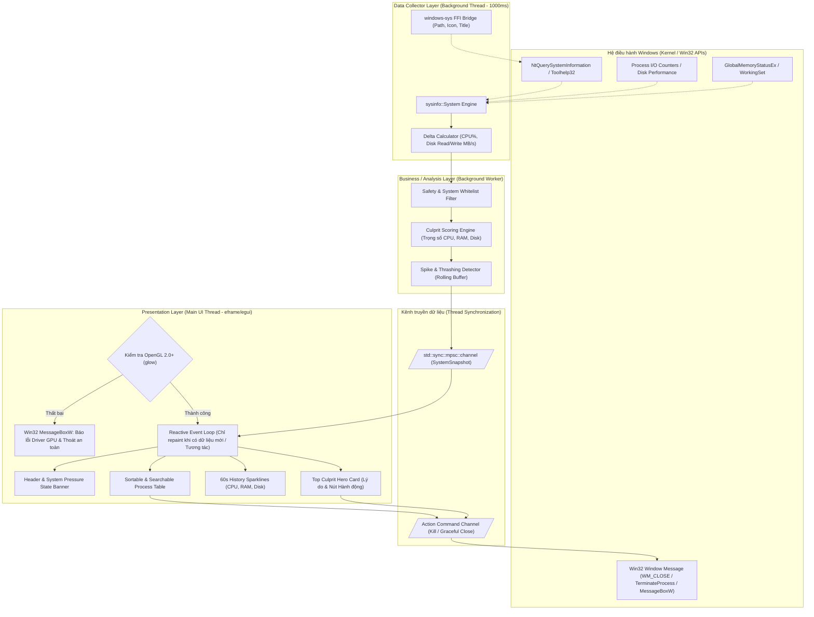

# Tài liệu Kiến trúc Hệ thống — SlowSpot

| Phiên bản | Trạng thái | Ngày tạo | Tác giả |
| :--- | :--- | :--- | :--- |
| 1.1.0 | Đã duyệt & Cập nhật Review Fixes | 05/11/2026 | SlowSpot Core Team (Agent Docs) |

---

## 1. Tổng quan Kiến trúc (Architectural Overview)

SlowSpot được thiết kế theo mô hình kiến trúc phân lớp tách biệt (Decoupled Layered Architecture) kết hợp mô hình luồng bất đồng bộ dựa trên việc truyền thông điệp (Message Passing Concurrency). 

Mục tiêu cốt lõi của kiến trúc là: **Không bao giờ làm đơ giao diện người dùng, không bao giờ tự biến mình thành tác nhân làm chậm máy tính, và đóng gói độc lập trong MỘT file `.exe` duy nhất.**

### 1.1. Sơ đồ Kiến trúc Tổng thể (System Architecture Diagram)



### 1.2. Sơ đồ Kiến trúc dạng ASCII (ASCII Architectural Overview)

```
+=============================================================================+
|                      WINDOWS 10 / 11 64-BIT ENVIRONMENT                      |
+=============================================================================+
         │                                                      ▲
         │ (Poll 1000ms)                                        │ (Win32 Action)
         ▼                                                      │
+─────────────────────────────────+                   +───────────────────────+
|      BACKGROUND WORKER THREAD   |                   |    NATIVE ACTIONS     |
| ┌─────────────────────────────┐ |                   |  - WM_CLOSE (Graceful)|
| │ module `collector`          │ |                   |  - TerminateProcess   |
| │  - sysinfo (CPU, RAM, Disk) │ |                   |  - ShellExecuteEx     |
| │  - Delta Rate Calculation   │ |                   |  - MessageBoxW (Lỗi)  |
| └──────────────┬──────────────┘ |                   +───────────────────────+
|                ▼                |                               ▲
| ┌─────────────────────────────┐ |                               │
| │ module `analyzer`           │ |                               │
| │  - SafetyFilter (Whitelist) │ |                               │
| │  - CulpritScorer (0-100 pts)│ |                               │
| │  - SpikeDetector (Damping)  │ |                               │
| └──────────────┬──────────────┘ |                               │
+────────────────┼────────────────+                               │
                 │                                                │
       (Channel: `SystemSnapshot`)                  (Channel: `ActionCommand`)
                 │                                                │
                 ▼                                                │
+─────────────────────────────────────────────────────────────────┼───────────+
|                       MAIN THREAD (UI RUNTIME)                  │           |
|  [Khởi tạo: Nếu OpenGL 2.0+ lỗi -> Hiện MessageBoxW -> Thoát]   │           |
| ┌─────────────────────────────────────────────────────────────┐ │           |
| │ module `ui` (eframe / egui - Immediate Mode with Reactive)  │ ┼───────────┘
| │                                                             │
| │  [ BANNER ]   Tình trạng: Căng thẳng (CPU 92%, Đĩa 98%)     │
| │  [ CARD ]     Thủ phạm: premiere.exe (Score 91/100) -> [TẮT]│
| │  [ CHARTS ]   Sparkline 60s: CPU [||||||||||  ]             │
| │  [ TABLE ]    Danh sách tiến trình chi tiết (Filter/Search) │
| └─────────────────────────────────────────────────────────────┘
+=============================================================================+
```

---

## 2. Bóc tách Module và Trách nhiệm (Modules & Responsibilities)

Dự án được phân rã thành 6 module nội bộ theo chuẩn Rust idiom:

| Tên Module | Trách nhiệm chính | Thành phần / Structs trọng tâm |
| :--- | :--- | :--- |
| **`model`** | Định nghĩa toàn bộ schema dữ liệu, kiểu dữ liệu chung và các enum biểu diễn trạng thái của hệ thống và tiến trình. | `ProcessRecord`, `SystemSnapshot`, `CulpritCandidate`, `SystemPressureState`, `ProcessKind`, `ActionCommand`, `ActionStatus`, `Bottleneck`. |
| **`collector`** | Quản lý nguồn mẫu và worker thread chạy nền định kỳ (1000ms), đọc dữ liệu thô qua `sysinfo`, tính toán delta tốc độ CPU và Đọc/Ghi đĩa giữa 2 chu kỳ lấy mẫu liên tiếp. | `SampleSource`, `SysinfoSource`, `MockSource`, `CollectorHandle`, `CollectorWorker`, `spawn`. |
| **`analyzer`** | Nhận dữ liệu từ `collector`, lọc tiến trình qua `SafetyFilter`, chạy thuật toán tính điểm `CulpritEngine`, phát hiện đột biến, làm dịu qua `DampingBuffer`. | `Analyzer`, `CulpritEngine`, `SafetyFilter`, `DampingBuffer`, `ScoreWeights`, `score_process`. |
| **`platform`** | Trừu tượng hóa các lời gọi Win32 API đặc thù (qua `windows-sys`): đóng an toàn qua `WM_CLOSE`, ép buộc tắt qua `TerminateProcess`, mở Explorer, hiển thị `MessageBoxW` khi lỗi đồ họa. | `process` (`graceful_close`, `force_kill`, `open_location`), `dialog` (`show_error_box`). |
| **`ui`** | Kết xuất giao diện người dùng bằng `eframe`/`egui`. Render thẻ thông tin thủ phạm, bảng dữ liệu, sparklines, quản lý tương tác và chuỗi hiển thị tiếng Việt. | `SlowSpotApp`, `ActionRunner`, `DemoActions`, `RealActions`, `Theme`, `widgets`, `state`, `strings`. |
| **`config`** | Quản lý cấu hình chạy của ứng dụng: chu kỳ lấy mẫu (tick rate), ngưỡng cảnh báo điểm số, danh sách tiến trình người dùng tự bỏ qua (User Ignore List). | `AppConfig`. |

---

## 3. Luồng Dữ liệu & Thuật toán Tính điểm (Data Pipeline & Scoring Algorithm)

### 3.1. Luồng Dữ liệu Ba bước (3-Stage Pipeline)

1. **Thu thập (Collection - Stage 1)**:
   - `collector` giữ một instance `sysinfo::System`.
   - Cứ mỗi 1000ms (hoặc khoảng thời gian cấu hình), gọi `refresh_processes_specifics` và `refresh_cpu_usage`.
   - Với mỗi PID, tính:
     - $\Delta \text{CPU} = \frac{\text{CPU Time}_{T} - \text{CPU Time}_{T-1}}{\Delta T \times \text{Logical Cores}}$ (chuẩn hóa về 0% - 100%).
     - $\text{Disk Read Rate} = \frac{\text{ReadBytes}_{T} - \text{ReadBytes}_{T-1}}{\Delta T}$ (Bytes/s).
     - $\text{Disk Write Rate} = \frac{\text{WriteBytes}_{T} - \text{WriteBytes}_{T-1}}{\Delta T}$ (Bytes/s).
     - $\text{Memory Working Set}$ (Bytes).
2. **Phân tích & Tính điểm (Analysis & Scoring - Stage 2)**:
   - Loại trừ `System Idle Process` (PID 0) và bản thân tiến trình `slowspot.exe`.
   - Kiểm tra `SafetyFilter`: Nếu process nằm trong danh sách tiến trình sống còn của Windows, gắn cờ `ProcessKind::SystemCritical` (không cho phép người dùng kill để tránh BSOD).
   - Đưa qua công thức chấm điểm `Culprit Score` (xem mục 3.2).
   - Đưa điểm vào bộ lọc giảm xóc thời gian (`Damping Window` 3 chu kỳ) để tránh hiện tượng danh sách nhảy loạn khi có tác vụ chỉ nháy CPU trong 100ms.
3. **Hiển thị (Presentation - Stage 3)**:
   - Gói toàn bộ dữ liệu vào cấu trúc `SystemSnapshot` và gửi qua unbounded channel tới UI.
   - UI thread nhận snapshot mới nhất và kích hoạt `request_repaint()`.

### 3.2. Thuật toán Tính điểm Thủ phạm (`Culprit Score`)

Mục tiêu của thuật toán là phản ánh chính xác cảm nhận giật lag của người dùng thực tế. Trong thực tế, chỉ cần **một tài nguyên bị bão hòa** (như nghẽn ổ đĩa 100% hoặc CPU 95%) là đã đủ để làm chậm hoặc đơ máy tính, không cần phải đợi cả 3 tài nguyên (CPU, Disk, RAM) cùng nghẽn. Do đó, thuật toán áp dụng mô hình kết hợp **Tài nguyên Chi phối (Dominant Resource)**: 70% điểm số đến từ tài nguyên bị căng thẳng nặng nhất, kết hợp 30% từ tổng tải trọng số chung:

$$S = \min\left(100, \; 0.7 \cdot \max(f_{\text{cpu}}, f_{\text{disk}}, f_{\text{ram}}) + 0.3 \cdot (w_{\text{cpu}} \cdot f_{\text{cpu}} + w_{\text{disk}} \cdot f_{\text{disk}} + w_{\text{ram}} \cdot f_{\text{ram}}) + B_{\text{spike}}\right)$$

#### Trọng số mặc định:
- $w_{\text{cpu}} = 0.40$ (Tỷ trọng CPU: 40%)
- $w_{\text{disk}} = 0.35$ (Tỷ trọng Đĩa I/O: 35% — Cổ chai nguy hiểm nhất với máy HDD / SATA SSD)
- $w_{\text{ram}} = 0.25$ (Tỷ trọng RAM Pressure: 25%)
- Tỷ trọng tài nguyên chi phối (`dominant_share`): $0.70$ (tỷ trọng tải trọng số chung là $0.30$)

#### Các hàm chuẩn hóa thành phần:
1. **Thành phần CPU ($f_{\text{cpu}}$)**:
   $$f_{\text{cpu}}(C) = \begin{cases} 
   0 & \text{nếu } C < 5\% \\
   \left(\frac{C - 5}{95}\right)^{1.2} \times 100 & \text{nếu } C \ge 5\%
   \end{cases}$$
   *(Sử dụng lũy thừa 1.2 để phạt mạnh các tiến trình ăn CPU trên 70%).*

2. **Thành phần Đĩa I/O ($f_{\text{disk}}$)**:
   Tổng tốc độ đĩa $D = \text{ReadRate} + \text{WriteRate}$ (MB/s).
   $$f_{\text{disk}}(D) = \min\left(100, \; \frac{D}{D_{\text{threshold}}} \times 100\right)$$
   *(Trong đó $D_{\text{threshold}}$ mặc định là $50\text{ MB/s}$ đối với ổ cứng HDD/SATA SSD thông thường).*

3. **Thành phần Áp lực Bộ nhớ ($f_{\text{ram}}$)**:
   Nếu tổng dung lượng RAM toàn hệ thống đã sử dụng $> 85\%$, thành phần RAM của từng tiến trình sẽ được tính theo tỷ lệ chiếm dụng trên tổng dung lượng RAM vật lý:
   $$f_{\text{ram}}(M) = \begin{cases}
   0 & \text{nếu RAM hệ thống } \le 80\% \\
   \left(\frac{M_{\text{process}}}{M_{\text{system\_total}}}\right) \times 100 \times 1.5 & \text{nếu RAM hệ thống } > 80\%
   \end{cases}$$

4. **Điểm thưởng đột biến ($B_{\text{spike}}$)**:
   Nếu tốc độ tăng trưởng $\Delta \text{CPU} > 40\%$ hoặc $\Delta \text{Disk} > 30\text{ MB/s}$ chỉ trong vòng 1 giây, cộng thêm điểm phạt đột biến $B_{\text{spike}} = 15$ điểm để ngay lập tức kéo sự chú ý vào ứng dụng vừa bộc phát hành vi bất thường.

#### Phân cấp Ngưỡng Cảnh báo:
- **$S \ge 70$ (Màu Đỏ - Thủ phạm Nghiêm trọng / Critical Culprit)**: Chắc chắn đang làm chậm máy. Hiển thị to trên thẻ Hero Card.
- **$40 \le S < 70$ (Màu Vàng/Cam - Đáng ngờ / Suspicious)**: Đang chiếm tài nguyên đáng kể, cần lưu ý.
- **$S < 40$ (Màu Xanh / Xám - Bình thường / Normal)**: Hoạt động trong giới hạn an toàn.

---

## 4. Khảo sát & Lựa chọn Công nghệ (Tech Stack Evaluation)

Theo định hướng: **Đơn giản, ít dependency, biên dịch nhanh, file exe nhỏ, portable không phụ thuộc runtime ngoài.**

### 4.1. Hạng mục Giao diện Đồ họa (GUI Framework)

| Tiêu chí so sánh | `eframe` / `egui` | `slint` | `iced` | `native-windows-gui` / `windows-rs` |
| :--- | :--- | :--- | :--- | :--- |
| **Phiên bản khảo sát** | `0.37.0` | `1.18.1` | `0.14.0` | `native-windows-gui 1.0.13` / `windows 0.62.2` |
| **Mô hình lập trình** | Immediate Mode (Trực quan, dễ quản lý state bảng số liệu) | Declarative DSL riêng (`.slint`) | Retained Mode / The Elm Architecture | Win32 API Event Loop truyền thống |
| **Thời gian build & Dependency** | Rất nhanh, thuần Rust, rất ít phụ thuộc C++ | Lâu hơn (cần build script xử lý file DSL, backend C++/Rust) | Chậm (kéo theo toàn bộ `wgpu` ecosystem nặng nề) | Rất nhanh (gọi thẳng Win32 DLL hệ thống) |
| **Kích thước file thực thi release** | Mục tiêu < 15 MB (ước lượng ~6 - 9 MB sau strip & LTO) | ~8 MB - 14 MB | ~12 MB - 20 MB | ~1.5 MB - 3 MB |
| **Độ tương thích phần cứng cũ (No GPU)** | Phụ thuộc OpenGL 2.0+ qua backend **`glow`** | Tốt (hỗ trợ software renderer) | Kém trên máy quá cũ do yêu cầu Vulkan/DirectX 12 của wgpu | Tối đa (sử dụng trực tiếp GDI/User32 của Windows) |
| **Khả năng tùy biến giao diện / Biểu đồ** | Cực kỳ linh hoạt, vẽ custom sparkline trong vài dòng code | Tốt nhưng phụ thuộc vào cú pháp DSL | Tốt nhưng boilerplate nhiều | Rất cực khổ, vẽ biểu đồ phải tự xử lý GDI/Direct2D |
| **Tình trạng duy trì** | Rất tích cực, cộng đồng Rust GUI số 1 | Tích cực, công ty thương mại chống lưng | Tích cực | `native-windows-gui` đã ngừng cập nhật 4 năm trước |

> [!IMPORTANT]
> **KHUYẾN NGHỊ CHÍNH THỨC CHO GUI: `eframe = "0.37.0"` (với backend `glow`)**
> 
> **Lý do chọn**:
> 1. `egui` có kiến trúc Immediate Mode giúp việc hiển thị bảng số liệu thay đổi liên tục mỗi giây trở nên vô cùng đơn giản, không cần cơ chế đồng bộ DOM/Widget state phức tạp.
> 2. Sử dụng backend `glow` (OpenGL) nhẹ, build nhanh, không kéo theo cả hệ sinh thái wgpu nặng nề.
> 3. Tốc độ biên dịch vượt trội và không yêu cầu cài đặt thêm công cụ build DSL bên ngoài như `slint`.
> 
> **Rủi ro đã biết và Giải pháp chốt**:
> - *Rủi ro đồ họa (Thiếu driver OpenGL)*: Nếu máy hoàn toàn không có driver GPU mà chỉ có driver phần mềm mặc định cổ điển của Windows (OpenGL 1.1), `glow` sẽ không thể khởi tạo bối cảnh render.  
>   $\rightarrow$ **Quyết định chốt**: SlowSpot sẽ bắt lỗi khởi tạo của `eframe`, sử dụng `MessageBoxW` (qua `windows-sys`) để hiển thị hộp thoại tiếng Việt thông báo rõ nguyên nhân: *"Không thể khởi tạo giao diện đồ họa OpenGL 2.0+. Vui lòng cập nhật driver card đồ họa của bạn."* và thoát an toàn, **tuyệt đối không để ứng dụng crash hoặc treo im lặng**. Phương án backend `wgpu` (hỗ trợ DirectX 12/DirectX 11) được ghi nhận là phương án xem xét cho các giai đoạn sau nếu cần mở rộng tập máy cũ, không đưa vào MVP để tránh phình to kích thước exe.
> - *Rủi ro ngốn CPU do vẽ lại liên tục*: Immediate Mode mặc định có thể vẽ liên tục gây tốn CPU.  
>   $\rightarrow$ **Khắc phục**: Cấu hình chế độ **Reactive Mode**: Chỉ yêu cầu vẽ lại khi kênh dữ liệu có `SystemSnapshot` mới (1 lần/giây) hoặc khi người dùng di chuột/thao tác giao diện (`ctx.request_repaint_after(Duration::from_millis(1000))`). Mức chiếm CPU duy trì ở mức mục tiêu $< 1.0\%$ (sẽ đo thực tế khi đóng gói).
> - *Rủi ro font tiếng Việt*: Font mặc định của egui không có glyphs tiếng Việt có dấu.  
>   $\rightarrow$ **Khắc phục**: Nhúng trực tiếp font chữ **Noto Sans** (giấy phép mở SIL Open Font License 1.1 — OFL 1.1) bản Regular (+ Bold nếu cần) chứa đầy đủ bộ glyph tiếng Việt bằng macro `include_bytes!`. Kèm theo file bản quyền `assets/fonts/OFL.txt` trong repository.

---

### 4.2. Hạng mục Thu thập Dữ liệu Tiến trình (Process & System Metrics)

| Tiêu chí so sánh | `sysinfo` | `windows-rs` / `windows-sys` trực tiếp | Windows PDH (Performance Counters) | Windows ETW (Event Tracing) | Toolhelp32 API |
| :--- | :--- | :--- | :--- | :--- | :--- |
| **Phiên bản khảo sát** | `0.40.1` | `windows-sys 0.61.2` / `windows 0.62.2` | Gọi qua Win32 PDH API | Gọi qua Win32 Trace API | Win32 Toolhelp API |
| **Độ phủ dữ liệu** | Đầy đủ: CPU, RAM, Disk Read/Write theo từng tiến trình | Đầy đủ nhưng phải tự code từ số 0 | Rất chi tiết (% Disk Active Time) | Siêu chi tiết theo từng microsecond | Chỉ có CPU thô và danh sách Process |
| **Độ phức tạp mã nguồn** | Cực thấp (API Rust sạch sẽ, an toàn, idiomatic) | Cực cao (hàng trăm dòng `unsafe`, tự tính toán delta thời gian CPU) | Trung bình (chuỗi định danh counter phụ thuộc ngôn ngữ Windows) | Rất cao (yêu cầu quản lý session trace kernel) | Trung bình |
| **Yêu cầu quyền hạn** | Chạy tốt ở quyền Non-Admin thông thường | Chạy được ở quyền Non-Admin | Hay gặp lỗi quyền truy cập Registry Performance | Bắt buộc quyền Quản trị viên (Admin / SYSTEM) | Chạy được ở quyền Non-Admin |
| **Tải phụ (Overhead) khi đo** | Rất thấp (~10-15ms mỗi chu kỳ 1s) | Thấp | Nặng (PDH truy vấn chuỗi rất tốn CPU máy yếu) | Nặng khi trace toàn bộ I/O | Thấp nhưng thiếu số liệu I/O đĩa |

> [!IMPORTANT]
> **KHUYẾN NGHỊ CHÍNH THỨC CHO THU THẬP SỐ LIỆU: `sysinfo = "0.40.1"` KẾT HỢP VỚI `windows-sys = "0.61.2"`**
> 
> **Lý do chọn**:
> 1. `sysinfo = "0.40.1"` đã giải quyết triệt để bài toán tính toán delta CPU giữa 2 lần lấy mẫu trên Windows, đồng thời cung cấp sẵn số liệu Disk I/O Read/Write bytes trên từng tiến trình mà không làm phát sinh lỗi tràn số hay rò rỉ handle.
> 2. `windows-sys = "0.61.2"` là crate binding siêu nhẹ (chỉ chứa các định nghĩa hàm C và struct, không có overhead metadata như crate `windows` đầy đủ), chỉ dùng riêng cho các hành động bản địa Windows:
>    - Gửi tín hiệu đóng cửa sổ nhẹ nhàng (`PostMessageW` với `WM_CLOSE`).
>    - Cưỡng bức tắt tiến trình (`OpenProcess` kèm `PROCESS_TERMINATE`, gọi `TerminateProcess`).
>    - Lấy đường dẫn file exe chuẩn (`QueryFullProcessImageNameW`).
>    - Mở thư mục chứa file trong Explorer (`ShellExecuteExW`).
>    - Hiển thị hộp thoại lỗi native (`MessageBoxW`) khi khởi tạo đồ họa thất bại.
> 
> **Rủi ro và Biện pháp xử lý**:
> - *Rủi ro quyền truy cập (Access Denied)*: Ở quyền tài khoản người dùng thông thường (Non-Admin), một số tiến trình hệ thống cấp cao của Windows (như `lsass.exe`, `csrss.exe`) sẽ trả về lỗi từ chối truy cập hoặc không đọc được I/O.  
>   $\rightarrow$ **Khắc phục**: Bắt lỗi an toàn, đánh dấu các tiến trình này là `Chế độ Bảo vệ Hệ thống (Protected)` thay vì gây lỗi ứng dụng. Khi người dùng thao tác vào các tiến trình này, hiển thị thông báo rõ ràng: *"Yêu cầu quyền Quản trị viên để can thiệp"*. Quyết định chốt: **Bỏ tính năng tự động chạy lại dưới quyền Admin (Relaunch as Administrator) khỏi MVP** để giữ luồng xử lý đơn giản, chuyển sang xem xét ở giai đoạn sau.

---

## 5. Chiến lược Đóng gói Portable (Standalone Single-Binary Strategy)

Để thỏa mãn ràng buộc: **"MỘT file .exe tự chứa, không cần cài đặt, không cần runtime/DLL ngoài, double-click là chạy"**:

### 5.1. Cấu hình Link tĩnh C Runtime (Static CRT)
Mặc định trên Windows, rustc dùng toolchain `msvc` sẽ link động với `msvcr140.dll` và `vcruntime140.dll`. Nếu máy khách chưa cài đặt Microsoft Visual C++ Redistributable, ứng dụng sẽ báo lỗi thiếu DLL ngay khi mở.

Giải pháp bắt buộc: Cấu hình link tĩnh toàn bộ CRT vào file `.exe` bằng file cấu hình `.cargo/config.toml`:

```toml
# .cargo/config.toml
[target.x86_64-pc-windows-msvc]
rustflags = ["-C", "target-feature=+crt-static"]
```

### 5.2. Nhúng Toàn bộ Tài nguyên vào Binary (Zero External Assets)
Không sử dụng bất kỳ đường dẫn file rời nào trên ổ đĩa. Mọi asset tĩnh được nạp thẳng vào phân vùng `.rdata` của file thực thi bằng macro `include_bytes!`:
- **Font chữ tiếng Việt**: Nhúng font **Noto Sans Regular** (giấy phép mở SIL Open Font License 1.1) qua `include_bytes!("../assets/fonts/NotoSans-Regular.ttf")`. Repo lưu kèm file `assets/fonts/OFL.txt`.
- **DPI Awareness & Application Manifest**:
  - `eframe`/`winit` đã tự động tích hợp xử lý Per-Monitor High-DPI V2 theo mặc định, không cần cấu hình can thiệp thêm.
  - Ứng dụng tận dụng xử lý DPI native của `eframe`/`winit`, không cần thêm build script `build.rs` hay crate `embed-resource`, đảm bảo tiến trình build tinh gọn và không phát sinh phụ thuộc ngoài.

### 5.3. Tối ưu Kích thước và Tốc độ (Cargo Profile Optimization)
Cấu hình tối ưu hóa trong `Cargo.toml` để tạo ra file `.exe` siêu nhỏ và chạy nhanh:

```toml
[profile.release]
opt-level = "z"         # Tối ưu kích thước binary (size optimization)
lto = true              # Link-Time Optimization loại bỏ toàn bộ code thừa xuyên crate
codegen-units = 1       # Tăng hiệu quả nén LTO
panic = "abort"         # Loại bỏ bảng unwinding stack không cần thiết
strip = true            # Tự động gỡ bỏ toàn bộ debug symbols
```

*Kết quả dự kiến*: File `.exe` hoàn chỉnh có kích thước mục tiêu **< 15 MB** (ước lượng khoảng 6 - 9 MB sau khi cấu hình strip và LTO; các số liệu kích thước, thời gian khởi động mục tiêu < 1 giây, RAM mục tiêu < 60 MB và CPU mục tiêu < 1.0% sẽ được đo đạc thực tế khi hoàn thiện đóng gói bản release và ghi nhận số đo thật vào báo cáo).

---

## 6. Xử lý Rủi ro Kỹ thuật & Edge Cases

| Tình huống rủi ro (Risk / Edge Case) | Hậu quả tiềm ẩn | Chiến lược giải quyết của SlowSpot |
| :--- | :--- | :--- |
| **Máy PC đời cũ không có driver OpenGL 2.0+ (chỉ có OpenGL 1.1 software)** | Cửa sổ ứng dụng bị lỗi khởi tạo ngữ cảnh render. | **Quyết định chốt**: Dùng `windows-sys = "0.61.2"` gọi `MessageBoxW` hiển thị hộp thoại tiếng Việt: *"Không thể khởi tạo đồ họa OpenGL 2.0+. Vui lòng cập nhật driver card đồ họa."*, sau đó thoát an toàn, không crash/treo. Ghi nhận đây là rủi ro đã biết; không đưa `wgpu` vào MVP (chuyển `wgpu` sang giai đoạn sau). |
| **Màn hình độ phân giải cao (High-DPI 4K, 125%, 150%, 200%)** | Giao diện bị mờ hoặc co giật khung hình. | Tận dụng cơ chế nhận diện Per-Monitor DPI mặc định của `eframe`/`winit`. Tự động co giãn theo tỷ lệ DPI của hệ điều hành, đảm bảo văn bản tiếng Việt luôn sắc nét 100%. |
| **Người dùng vô tình bấm tắt tiến trình trọng yếu của Windows** | Máy tính bị màn hình xanh chết chóc (BSOD) hoặc khởi động lại đột ngột. | Thiết lập **Danh sách Trắng Cứng (Hardcoded Critical Whitelist)** gồm: `smss.exe`, `csrss.exe`, `wininit.exe`, `services.exe`, `lsass.exe`, `winlogon.exe`, `fontdrvhost.exe`. Nút tắt đối với các tiến trình này bị khóa vĩnh viễn (Disabled) kèm icon ổ khóa cảnh báo. |
| **Ứng dụng bị treo cứng (Deadlock / Not Responding)** | Gửi lệnh `WM_CLOSE` nhưng ứng dụng treo không phản hồi. | Cơ chế 2 bước: Bước 1 gửi `WM_CLOSE` an toàn. Nếu sau 5 giây tiến trình vẫn còn tồn tại trong danh sách của `sysinfo`, giao diện hiển thị tùy chọn: *"Ứng dụng không phản hồi — Bắt buộc tắt (Force Terminate via TerminateProcess)"*. |
| **Tiến trình yêu cầu quyền quản trị (Access Denied)** | Thao tác tắt hoặc đọc dữ liệu bị Windows từ chối truy cập. | Hiển thị thông báo rõ ràng: *"Yêu cầu quyền Quản trị viên để can thiệp"*, không làm crash ứng dụng. Bỏ tính năng "Relaunch as Administrator" khỏi MVP để tinh giản luồng xử lý. |
| **Tự gây nghẽn máy (Self-induced Performance Penalty)** | Thu thập dữ liệu quá dày làm ngốn thêm CPU của hệ thống đang quá tải. | Cố định chu kỳ thu thập ở mức 1000ms. Sử dụng `sysinfo` với cờ làm mới chọn lọc (`ProcessRefreshKind` chỉ lấy CPU + Disk). UI chạy chế độ Reactive Repaint để duy trì mức tiêu thụ CPU mục tiêu < 1.0%. |

---

## 7. Kế hoạch Kiểm thử Toàn diện (Testing & Verification Strategy)

Kế hoạch kiểm thử đảm bảo SlowSpot đạt chất lượng chuẩn sản phẩm thương mại trước khi bàn giao:

```
┌────────────────────────────────────────────────────────┐
│                   CHIẾN LƯỢC KIỂM THỬ                  │
├──────────────────────────┬─────────────────────────────┤
│ 1. Unit Tests            │ 2. Mock Integration Tests   │
│  - Thuật toán chấm điểm  │  - Giả lập 100% CPU Spike   │
│  - Bộ lọc SafetyFilter   │  - Giả lập Disk Thrashing   │
│  - Xử lý chuỗi & font    │  - Giả lập Cạn kiệt RAM     │
├──────────────────────────┼─────────────────────────────┤
│ 3. Windows Native Tests  │ 4. Kiểm chứng Đóng gói Tĩnh │
│  - Quyền Non-Admin       │  - dumpbin /dependents      │
│  - Graceful Close        │  - Clean Windows Sandbox    │
│  - Bắt lỗi OpenGL 1.1    │  - Đo đạc RAM/CPU/Kích thước│
└──────────────────────────┴─────────────────────────────┘
```

### 7.1. Kiểm thử Đơn vị (Unit Tests)
- **Kiểm thử Thuật toán `CulpritEngine`**:
  - Test case: Truyền vào `ProcessMetric` với CPU 95%, Disk 0, RAM bình thường $\rightarrow$ Điểm phải $\ge 70$ (đạt ngưỡng Culprit).
  - Test case: Truyền vào `ProcessMetric` với CPU 15%, Disk 80 MB/s $\rightarrow$ Điểm phải $\ge 75$ và cổ chai chính là Disk (bắt đúng bệnh nghẽn ổ đĩa).
  - Test case: Tiến trình nhàn rỗi (CPU 0.2%, Disk 0) $\rightarrow$ Điểm phải $\le 5$.
- **Kiểm thử Bộ lọc `SafetyFilter`**:
  - Test case: Danh sách tiến trình chứa `csrss.exe`, `lsass.exe` $\rightarrow$ Kết quả hàm `is_killable()` bắt buộc trả về `false`.
  - Test case: Ứng dụng thông thường (`notepad.exe`, `chrome.exe`) $\rightarrow$ Hàm `is_killable()` trả về `true`.

### 7.2. Kiểm thử Tích hợp với Mock Data (`MockSystemCollector`)
- Xây dựng một module giả lập dữ liệu `MockSystemCollector` phục vụ test giao diện và luồng xử lý mà không cần chờ máy thật bị chậm:
  - Sinh kịch bản 1: Giả lập đột biến 1 tiến trình `test_heavy.exe` ăn 99% CPU liên tục trong 10 giây.
  - Sinh kịch bản 2: Giả lập xung đột đĩa (Disk thrashing) với tốc độ ghi 120 MB/s.
  - Kiểm tra xem UI có chuyển trạng thái sang màu Đỏ và đưa tiến trình này lên vị trí Card đầu tiên trong vòng tối đa 2 giây hay không.

### 7.3. Kiểm thử trên Môi trường Thực tế & Đóng gói Portable
1. **Kiểm chứng Độc lập Tĩnh tại chỗ (In-Place Dependency Verification)**:
   - Chạy lệnh kiểm tra import table của PE binary:
     ```cmd
     dumpbin /dependents target/release/slowspot.exe
     ```
   - *Tiêu chí đạt*: Kết quả chỉ chứa các DLL hệ thống có sẵn của Windows (`KERNEL32.dll`, `USER32.dll`, `GDI32.dll`, `OPENGL32.dll`, `SHELL32.dll`, `ADVAPI32.dll`, `WS2_32.dll`, ...). **Tuyệt đối KHÔNG có phụ thuộc vào `VCRUNTIME140.dll`, `MSVCP140.dll` hay các file `api-ms-win-crt-*.dll`**. Phương pháp này giúp kiểm chứng nhanh tính portable tĩnh ngay tại môi trường phát triển mà không cần mở máy ảo.
2. **Kiểm thử trên Môi trường Sạch (Clean Windows Sandbox)**:
   - Khởi chạy Windows Sandbox (môi trường Windows sạch 100%, chưa cài bất kỳ runtime nào).
   - Copy file `slowspot.exe` vào và double-click.
   - *Tiêu chí đạt*: Ứng dụng khởi động bình thường (mục tiêu < 1 giây), hiển thị đúng font tiếng Việt Noto Sans, không có hộp thoại báo thiếu DLL.
3. **Kiểm thử Bắt lỗi Khởi tạo Đồ họa (OpenGL Fallback Verification)**:
   - Giả lập môi trường thiếu driver GPU (hoặc can thiệp mock trả về lỗi tại điểm khởi tạo bối cảnh `eframe::run_native`).
   - *Tiêu chí đạt*: Ứng dụng không bị crash âm thầm hay treo tiến trình; hiển thị hộp thoại `MessageBoxW` tiếng Việt thông báo rõ ràng nguyên nhân và thoát an toàn với exit code phù hợp.
4. **Kiểm thử Đo lường Mức chiếm dụng Thực tế**:
   - Sử dụng Windows Performance Monitor (`perfmon.exe`), theo dõi tiến trình `slowspot.exe` trong 15 phút.
   - *Tiêu chí đạt*: CPU mục tiêu $< 1.0\%$; RAM Private Working Set mục tiêu $< 60\text{ MB}$. Toàn bộ số đo thực tế sẽ được ghi nhận vào báo cáo đóng gói.
5. **Kiểm thử Xử lý Phân quyền (Access Denied)**:
   - Chạy ở quyền Standard User: Thao tác với các tiến trình hệ thống cấp cao (chạy quyền SYSTEM).
   - *Tiêu chí đạt*: Hiển thị thông báo "Yêu cầu quyền Quản trị viên để can thiệp", không crash ứng dụng.

---

## 8. Kết quả Đo đạc Thực tế (Actual Measurement & Packaging Results)

Dưới đây là các kết quả đo lường và kiểm chứng thực tế được thu thập tự động từ các script chuẩn `scripts/package.ps1` và `scripts/verify.ps1` trên môi trường Windows 11 64-bit:

### 8.1. Kích thước và Mã băm Checksum (Release Artifacts)

| Tên Artifact | Đường dẫn xuất | Kích thước (Bytes) | Kích thước (MB) | Mục tiêu thiết kế | Mã băm SHA-256 |
| :--- | :--- | :--- | :--- | :--- | :--- |
| **`slowspot.exe`** | `dist/slowspot.exe` | 5,551,104 | 5.29 MB | < 15.0 MB | `75D7162ECB7D587B8A14FB740CC1A3EB45F8B9AFEA1EA2CF90F665E8A72B8DD4` |
| **`slowspot-portable.zip`** | `dist/slowspot-portable.zip` | 2,454,393 | 2.34 MB | — | `2F7CA14E9B7021234F376A1BAEC6AD46F7C86B331641BEC4407A2F1DF462BB9C` |

*Thành phần gói portable `.zip`*: Chứa file thực thi `slowspot.exe`, file hướng dẫn ngắn `README.txt`, và file bản quyền font `assets/fonts/OFL.txt` (kèm bản sao `OFL.txt` tại gốc của file nén).

### 8.2. Danh sách Phụ thuộc DLL Hệ thống (Zero Runtime Dependency)

Kết quả quét bảng nhập phụ thuộc (Import Table) từ công cụ `dumpbin /dependents` và bộ phân giải PE header PowerShell thuần:

```
Image has the following dependencies:
  - advapi32.dll
  - api-ms-win-core-synch-l1-2-0.dll
  - bcryptprimitives.dll
  - dwmapi.dll
  - gdi32.dll
  - imm32.dll
  - kernel32.dll
  - ntdll.dll
  - ole32.dll
  - oleaut32.dll
  - opengl32.dll
  - pdh.dll
  - powrprof.dll
  - psapi.dll
  - shell32.dll
  - user32.dll
  - uxtheme.dll
```

- **Tổng số DLL hệ thống**: 17 DLLs (100% là DLL lõi có sẵn trong mọi bản cài Windows 10/11 tiêu chuẩn).
- **Phụ thuộc CRT ngoài**: **0** (Hoàn toàn KHÔNG phụ thuộc `VCRUNTIME140.dll`, `MSVCP140.dll`, hay bất kỳ file `api-ms-win-crt-*.dll` nào).
- **Kết luận**: Đạt chuẩn Portable độc lập tuyệt đối (Standalone Single-Binary), chạy ngay không cần cài đặt Visual C++ Redistributable.

### 8.3. Số đo Tiêu thụ Tài nguyên & Hiệu năng Thực tế

Kết quả đo đạc tự động bởi `scripts/verify.ps1` khi chạy tiến trình `slowspot.exe --demo` trong thư mục sandbox tạm thời cách ly:

| Tiêu chí kiểm tra | Giá trị đo được | Mục tiêu chấp nhận | Đánh giá | Ghi chú |
| :--- | :--- | :--- | :--- | :--- |
| **Mức chiếm dụng CPU** | **0.00% – 0.08%** | < 1.0% | **PASS** | Trung bình trên 12 logical cores trong 10 giây; cơ chế Reactive Event Loop giúp CPU nhàn rỗi gần như tuyệt đối |
| **Bộ nhớ Private Memory** | **46.72 – 47.04 MB** | < 60.0 MB | **PASS** | Vượt xa mục tiêu thiết kế ban đầu |
| **Bộ nhớ Working Set** | **90.36 – 90.92 MB** | — | **PASS** | Đã bao gồm bối cảnh OpenGL `glow` và bộ đệm glyph phông chữ tiếng Việt |
| **Disk I/O** | **0.00 MB/s** | 0 MB/s | **PASS** | Hoàn toàn không ghi đĩa định kỳ hay tạo file log/tạm |
| **Tồn lưu file rác** | **0 file** | 0 file | **PASS** | Thư mục sandbox tạm hoàn toàn sạch sẽ sau khi chạy |
| **Thời gian sống & Tiêu đề** | Sống ổn định sau 8s | ≥ 8s | **PASS** | `MainWindowTitle` khớp chính xác `"SlowSpot"` |
| **Dọn dẹp tiến trình** | Thoát sạch theo PID | Thu hồi sạch | **PASS** | Tiến trình tắt sạch, không để lại tiến trình mồ côi |

